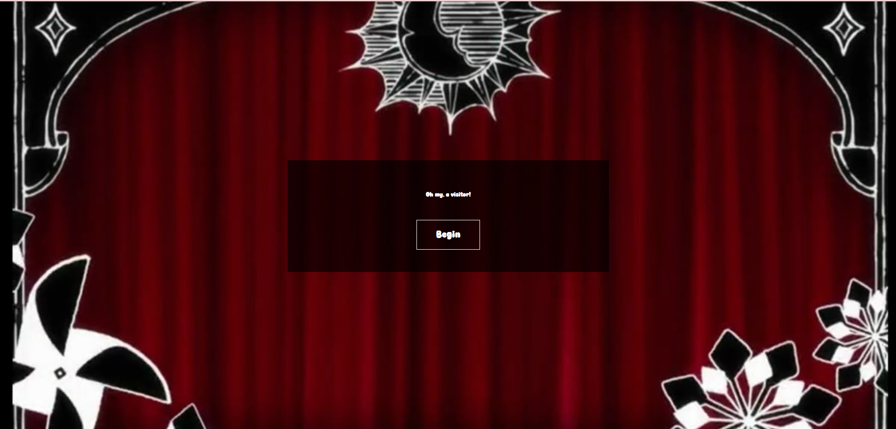
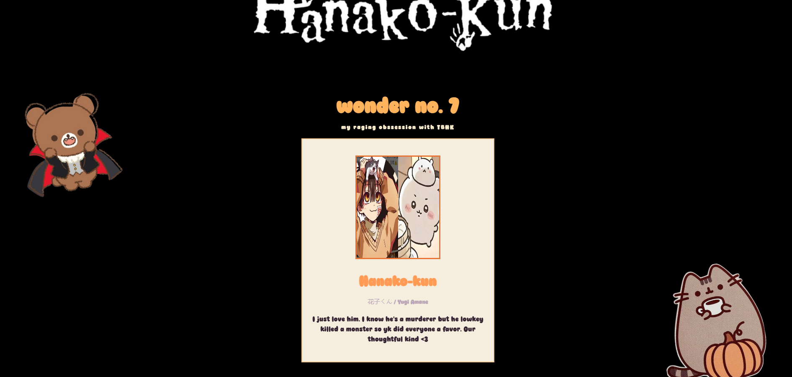

## wonder no. 7

# What It Is

It's a website that's supposed to be narrated in this eerie megaphone, waring you and telling you about the seventh school wonders in TBHK. I wanted to do all the 7 but couldn't because of time constraints :( Will update soon though.

# Why I Made It

I was watching a TBHK edit on tikok, and remembered the green haired rumor spreader girl and her eerir voice. She spreads rumors about the ghosts so wanted to atleast add that part into the project :3 Also I love that jumpscare image lol

# How I Made It

Tech stack:

- HTML
- CSS
- JS

The hardest part is just styling because I tend to overdo it and everything breaks </3

# What I Learnt and What I Struggled With

Making eerie onboarding page is fun, I like adding my voice to stuff too. I kinda struggled with finding sites for it because everything was ai but found some random one that I think worked well lol

# Screenshots

